<!-- animated contribution graph: real data, refreshed daily by
     .github/workflows/update-profile-art.yml -->

<h3><code>vishal@github ~ $ ./contributions.sh</code></h3>

 
 

<!-- ascii portrait (left) + neofetch card (right), both 840x880.
     portrait: pip install -r scripts/requirements-portrait.txt
               python scripts/prep_photo.py source-photo.jpg && python scripts/make_ascii_svg.py
     card:     edit LINES in scripts/make_info_card.py, then run it -->

<h3><code>vishal@github ~ $ whoami</code></h3>

<table>
<tr>
<td valign="top"></td>
<td valign="top"></td>
</tr>
</table>

 

<h3><code>vishal@github ~ $ ./stats.sh</code></h3>

 
 

<h3><code>vishal@github ~ $ ls ~/projects</code></h3>

<table>
<tr>
<td width="430" valign="top">
<a href="https://github.com/vishalguptax/claude-code-manager"><b>claude-code-manager</b></a> 
VS Code extension: Claude Code sessions, MCP servers, skills, usage &amp; accounts in your sidebar. 100% local.
</td>
<td width="430" valign="top">
<a href="https://github.com/vishalguptax/media-context-mcp"><b>media-context-mcp</b></a> 
Local MCP server that gives agents video, audio &amp; image context: frames, transcripts, OCR. No API keys.
</td>
</tr>
<tr>
<td valign="top">
<a href="https://github.com/vishalguptax/agent-skills"><b>agent-skills</b></a> 
Practical, tested skills for AI coding agents (Claude Code, Codex, Cursor, Copilot, Gemini CLI).
</td>
<td valign="top">
<a href="https://github.com/vishalguptax/agent-engineering-kit"><b>agent-engineering-kit</b></a> 
Rules, skills, agents and hooks for running Claude Code like an engineering team.
</td>
</tr>
<tr>
<td valign="top">
<a href="https://github.com/vishalguptax/code-clip"><b>code-clip</b></a> 
Share code snippets with expiring links.
</td>
<td valign="top">
<a href="https://github.com/vishalguptax/api-tester"><b>api-tester</b></a> 
Test API responses right in the browser.
</td>
</tr>
</table>

 

<h3><code>vishal@github ~ $ cat stack.txt</code></h3>

 
 

<h3><code>vishal@github ~ $ ./links.sh</code></h3>

 

